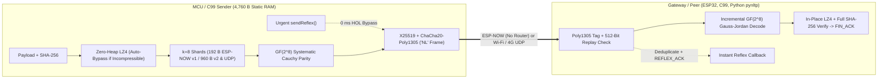

# NLTP v1.6.0 — Zero-Malloc ANSI C99, Arduino, PlatformIO & ESP-IDF Wireless Transport

[](https://github.com/indian-aman/NLTP-Arduino/actions/workflows/tier1-compliance.yml)
[](https://github.com/indian-aman/NLTP-Arduino/actions/workflows/codeql.yml)
[](https://www.bestpractices.dev/en/projects/16811)
[](https://scorecard.dev/viewer/?uri=github.com/indian-aman/NLTP-Arduino)
[](https://datatracker.ietf.org/doc/draft-bains-nltp/)
[](https://components.espressif.com/components/indian-aman/nltp)
[](https://registry.platformio.org/libraries/indian-aman/NLTP)
[](LICENSE)

**Loss-healing, forward-secret (`X25519 + ChaCha20-Poly1305`) binary, telemetry, and priority-command transport in `4,760` bytes of static C99 RAM (`0` `malloc`, `0` floats) — running identically over routerless 2.4 GHz `ESP-NOW` (`v1` & `v2`) and `UDP/IP` across `ESP32`, `ESP8266`, `STM32`, `RP2040`, Linux, and Python (`pynltp`).**

[**Interactive Wire Lab**](https://indian-aman.github.io/necklink/nltp/) · [**IETF Draft (`draft-bains-nltp-00`)**](https://datatracker.ietf.org/doc/draft-bains-nltp/) · [**ESP-IDF Registry**](https://components.espressif.com/components/indian-aman/nltp) · [**Examples (`examples/`)**](examples/) · [**Python / JS / Java Peers (`necklink`)**](https://github.com/indian-aman/necklink/tree/main/packages/nltp)

---

## Why NLTP Exists

Standard embedded transports break down when wireless links drop `10–35%` of packets through concrete walls, basements, warehouses, or outdoor RF interference:

| Constraint on Noisy RF (`15–35%` Loss) | Raw `ESP-NOW` | `MQTT` / `HTTP` over `TCP` | **`NLTP v1.6.0` (`C99` / `Arduino` / `ESP-IDF`)** |
| :--- | :---: | :---: | :---: |
| **Multi-KB Payload Delivery (`8–64 KB`)** | Drops whole payload if 1 chunk is lost (`250 B` v1 / `1,470 B` v2 limit) | Stalls for seconds on exponential TCP RTO backoff | **`100%` SHA-256 verified** — `GF(2^8)` Cauchy FEC heals lost shards in flight |
| **Peer Encryption Limit** | Capped at `6–17` hardware LMK peers (`ESP_ERR_ESPNOW_FULL`) | Heavy `mbedTLS` / TLS `40+ KB` heap per socket | **Unlimited peers in software** — `1`-RTT `X25519 + PSK` PFS + `ChaCha20-Poly1305` |
| **Replay & Forgery Protection** | None (accepts replayed or spoofed MAC frames) | Per-TCP session | **`RFC 6479` `512`-packet anti-replay window** (`160/160` forged/replayed frames dropped pre-FEC) |
| **Emergency Stop / Control Latency** | Unconfirmed fire-and-forget | Head-of-line blocked behind stalled data segments | **`0 ms` HOL `sendReflex()` priority lane** with confirmed `PT_REFLEX_ACK` |
| **Telemetry Bandwidth Efficiency** | Raw bytes | Raw bytes (unless external gzip/zlib heap added) | **Built-in zero-malloc `LZ4` codec** (`4x–7x` smaller CSV/JSON; auto-bypasses JPEGs) |
| **MCU Static RAM Footprint** | `< 1 KB` | `15–50+ KB` dynamic heap | **`4,760` bytes exact** (`-DNLTP_TX_ONLY=1`, `0` `malloc`, `0` floats) |

---

## Wire Pipeline



---

## 1-Line Installation

### 1. Arduino IDE Library Manager
Open **Tools -> Manage Libraries...**, search **`NLTP`**, and click **Install** — or via `arduino-cli`:
```bash
arduino-cli lib install "NLTP"
```

### 2. PlatformIO (`platformio.ini`)
```ini
lib_deps =
    indian-aman/NLTP@^1.6.0
; Optional for 80 KB ESP8266 / small Cortex-M sensors (4,760 B static RAM):
build_flags = -DNLTP_TX_ONLY=1
```

### 3. Official Espressif ESP-IDF Component Manager (`v5.0+`, All 9 ESP32 Targets)
```bash
idf.py add-dependency "indian-aman/nltp^1.6.0"
```

### 4. Standalone CMake (`Linux` / `macOS` / `Windows` / Bare-Metal C99)
```bash
cmake -B build -DCMAKE_BUILD_TYPE=Release && cmake --build build
ctest --test-dir build --output-on-failure
```

### 5. Python Gateway / Host Receiver (`Raspberry Pi`, `Linux`, `ROS 2`, `MQTT` Bridge)
```bash
pip install pynltp
```

---

## 30-Second Arduino Quickstart

### A. Routerless `ESP-NOW` Encrypted + FEC Sensor (`ESP32` or `ESP8266`)
```cpp
#include <WiFi.h>
#include <NLTP.h>

NLTPESPNowNode radio;
const uint8_t GATEWAY_MAC[6] = {0x24, 0x0A, 0xC4, 0x00, 0x00, 0x02};
const char   *SHARED_PSK     = "replace-with-32B-key-from-nltp-gen-key";
static char   batchCsv[1024];

void setup() {
  Serial.begin(115200);
  WiFi.mode(WIFI_STA);
  radio.begin(/*channel=*/6, SHARED_PSK, NLTP_ESPNOW_RATE_AUTO, /*rxCapBytes=*/0);
  radio.setPeerMac(GATEWAY_MAC);
}

void loop() {
  radio.poll();

  // Send multi-KB sensor batch: survives up to 35% dropped RF frames, SHA-256 verified end-to-end
  if (radio.isSendComplete()) {
    int n = snprintf(batchCsv, sizeof(batchCsv), "uptime_ms,vbat\n%lu,3.98\n", millis());
    radio.sendBytes((const uint8_t *)batchCsv, n, "telemetry.csv");
  }
}
```

### B. Ultra-Light `4.76 KB` RAM `Wi-Fi / Cellular UDP` + `LZ4` + Instant Reflex Commands
```cpp
#include <NLTP.h>

NLTPWiFiNode nltp;
static uint8_t lz4Scratch[2048];

// Inside setup() after WiFi.begin():
nltp.begin(/*localPort=*/0, SHARED_PSK, /*rxCapBytes=*/0);
nltp.setPeer(IPAddress(192, 168, 1, 100), 9700);

// Compress 4x-7x with zero-heap LZ4, encrypt with X25519+ChaCha20, heal packet drops with Cauchy FEC:
nltp.sendBytesCompressed((const uint8_t *)csvBuf, csvLen, lz4Scratch, sizeof(lz4Scratch), "aqms.csv");

// Receive sub-millisecond confirmed commands (E-stop, relay toggle) even in NLTP_TX_ONLY=1 mode:
uint8_t cmd[128]; uint16_t cmdLen = 0;
if (nltp.popReflex(cmd, sizeof(cmd), &cmdLen)) { /* act immediately */ }
```

Full turnkey sketches in [`examples/`](examples/):
- [`ESP32_ESPNow_Sensor_Node`](examples/ESP32_ESPNow_Sensor_Node/ESP32_ESPNow_Sensor_Node.ino) & [`ESP32_ESPNow_Gateway`](examples/ESP32_ESPNow_Gateway/ESP32_ESPNow_Gateway.ino) — battery ESP-NOW sensor -> dual-mode ESP32 gateway -> Python UDP server
- [`ESP8266_UltraLight_LZ4_Sensor`](examples/ESP8266_UltraLight_LZ4_Sensor/ESP8266_UltraLight_LZ4_Sensor.ino) — `4,760 B` static RAM `LZ4` + `X25519` sensor for `80 KB` `ESP8266`
- [`ESP32_Encrypted_Receiver`](examples/ESP32_Encrypted_Receiver/ESP32_Encrypted_Receiver.ino), [`ESP32_Marine_Buoy_Sender`](examples/ESP32_Marine_Buoy_Sender/ESP32_Marine_Buoy_Sender.ino), [`ESP32_Relay_CGNAT_Node`](examples/ESP32_Relay_CGNAT_Node/ESP32_Relay_CGNAT_Node.ino), [`ESPNowV2Interop`](examples/ESPNowV2Interop/ESPNowV2Interop.ino)

---

## Measured Hardware Benchmarks (`ESP32-D0WDQ6` + `ESP8266EX NodeMCU` + `ESP32-D0WD-V3`)

Tested over live Channel 11 2.4 GHz RF (`wifi_sta=0`, `ip=0.0.0.0`):

| Hardware Scenario | Payload & RF Loss | Raw `ESP-NOW` | **`NLTP` (`X25519` + `ChaCha20` + `Cauchy FEC`)** |
| :--- | :--- | :---: | :---: |
| **`ESP8266 -> ESP32` Loss Sweep** (`242 B` v1 frames) | `8 KB` @ `10%, 25%, 35%` loss | `0 / 3` (`0%` complete) | **`3 / 3` (`100%` SHA-256)** at all loss levels (`1.00–0.58 Mbps`) |
| **2-Hop Single-Channel Relay** (`ESP8266 -> ESP32 -> ESP32`) | `8 KB` @ `-78 dBm` + `15%` loss | `0 / 3` (`2.8 / 8 KB` avg) | **`3 / 3` (`100%` SHA-256)** |
| **2-Hop Relay Through `250 B` `ESP8266`** (`ESP32 -> 8266 -> ESP32`) | `8 KB` @ `0%` & `15%` loss | `0%`: `3/3` · `15%`: `0/3` | **`3 / 3` (`100%` SHA-256)** (`3.27 Mbps` @ `0%`, `0.66 Mbps` @ `15%`) |
| **Simultaneous Full-Duplex Stress** (`32 KB A->B` + `32 KB B->A`) | `64 KB` total @ `10%` loss | `0 / 5` | **`5 / 5` (`100%` SHA-256, `3.05 Mbps`)** |
| **Adversarial Frame Injection** (`Spoofed MAC / Replay / Bit-Flip`) | `160` attack frames | Accepted spoofed frames | **`160 / 160` rejected pre-FEC** (`0` hub slots allocated) |
| **`50 x 8 KB` Soak + Deep-Sleep Cold Wake** | `400 KB` + `20` cold wakes | — | **`50 / 50` verified (`0 B` RX heap delta, `4.34 ms` median wake)** |

*(Note: On a `0%`-loss clean bench link, unencrypted raw ESP-NOW v2 reaches `15.0 Mbps` median vs. `7.1 Mbps` median for encrypted NLTP; NLTP is designed for links where dropped frames, multi-KB payloads, encryption, or CGNAT break raw datagrams and stall TCP.)*

---

## Standards, Security & Formal Verification

Every push runs strict C99 static analysis, memory sanitizers, adversarial fuzzing, and cryptographic vector gates:

| Assurance Gate | Verification Scope |
| :--- | :--- |
| **IETF Internet-Draft** | [`datatracker.ietf.org/doc/draft-bains-nltp/`](https://datatracker.ietf.org/doc/draft-bains-nltp/) ([TXT](spec/draft-bains-nltp-00.txt) · [XML](spec/draft-bains-nltp-00.xml)) — active 15-page IETF specification of `"NL"` wire frames, `X25519` handshake, `GF(2^8)` Cauchy FEC, and `LZ4` |
| **NIST & IETF Cryptographic KATs** | [`tests/test_kat_vectors.c`](tests/test_kat_vectors.c) — **`1,668 / 1,668` checks** against **RFC 7748** (`X25519` + all 7 low-order curve points), **RFC 8439** (`ChaCha20-Poly1305`), **RFC 4231** (`HMAC-SHA256`), **NIST FIPS 180-4** (`SHA-256`), **RFC 6479** (`512`-bit anti-replay), and `4,760 B` footprint gate (`docker run --rm ghcr.io/indian-aman/nltp-kat:v1.6.0`) |
| **Continuous `libFuzzer` + `CodeQL`** | [`fuzz/fuzz_nltp_rx.c`](fuzz/fuzz_nltp_rx.c) — **`500,000` mutated frames per CI push** under `clang -fsanitize=fuzzer,address,undefined` + GitHub `CodeQL` C99 `security-extended` SAST |
| **MISRA C:2012 Audit** | [`docs/MISRA_C_2012_COMPLIANCE.md`](docs/MISRA_C_2012_COMPLIANCE.md) — `-std=c99 -Wall -Wextra -Wpedantic -Werror -DNLTP_NO_MALLOC`, `0` dynamic allocations, `0` floats, `0` recursion, automated `cppcheck --addon=misra` |
| **OpenSSF & Supply-Chain Provenance** | [OpenSSF Best Practices Passing (`#16811`)](https://www.bestpractices.dev/en/projects/16811), [OpenSSF Scorecard (`8.1/10`)](https://scorecard.dev/viewer/?uri=github.com/indian-aman/NLTP-Arduino), [`sbom.spdx.json`](sbom.spdx.json) (SPDX 2.3), [`sbom.cdx.json`](sbom.cdx.json) (CycloneDX 1.5), and Sigstore `.intoto.jsonl` SLSA Build Provenance |

---

## Contributing & License

Contributions, hardware port reports (`STM32`, `RP2040`, `nRF52`, `Sub-GHz LoRa`), and security disclosures are welcome — see [`CONTRIBUTING.md`](CONTRIBUTING.md) and [`SECURITY.md`](SECURITY.md).

Licensed under the **[MIT License](LICENSE)**. If NLTP saves you from debugging dropped ESP-NOW or Wi-Fi UDP packets, consider starring the repository so other embedded developers can find it.
